# Cloud Architect Agent

[](https://github.com/samiulhuda360/cloud-architect-agent/actions/workflows/ci.yml)


**Describe the system you need in plain business terms, add your company's policies, and get a complete cloud
design for your part of the world: priced in your own currency, checked against your rules, drawn as a diagram and
ready to build.**

**[Try the live demo](https://cloud.188-245-30-93.sslip.io)**: no sign-up. Pick one of the real-life examples or
fill in your own, and press **Design it**. The public demo runs the rule-based architect with today's Azure prices;
the AI agent mode needs your own model key when you run it yourself.

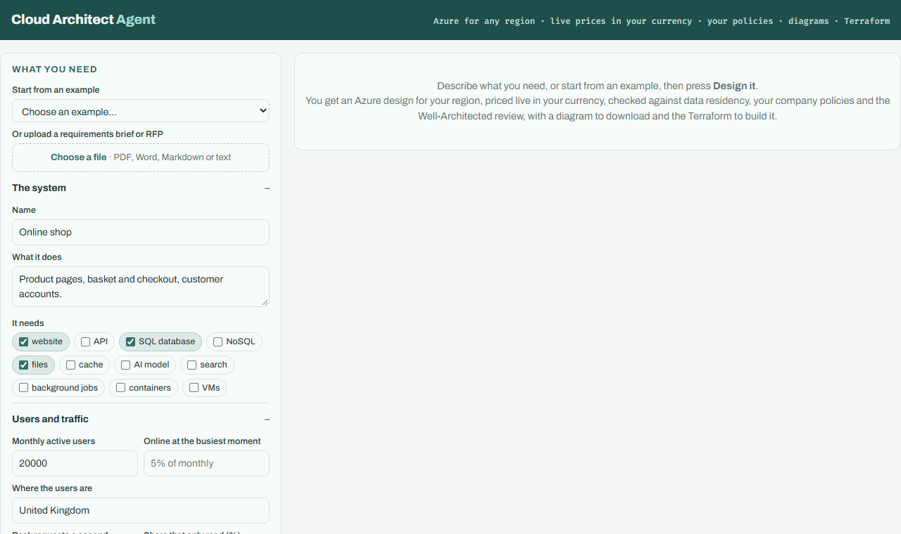

*The whole flow in under a minute: pick an example (or fill in your own), press **Design it**, and read the result:
the monthly cost against the budget, a map of the design, the price of every part, what was checked, and the files
an engineer needs.*

## What it does

You describe what you want to run online (a shop, a patient portal, a supplier portal), how many people will use
it, where they are, how much data you keep, how quickly you must recover from an outage and what you can spend. You
can also upload your company's security or data policy, and the tool picks out the rules in it for you to approve.
It returns a ready-made plan for Microsoft's Azure cloud in the right country, the monthly price of every piece in
your currency from today's price list, a diagram, a list of anything that breaks your rules, and the setup files an
engineer needs to build it.

## A real-life example

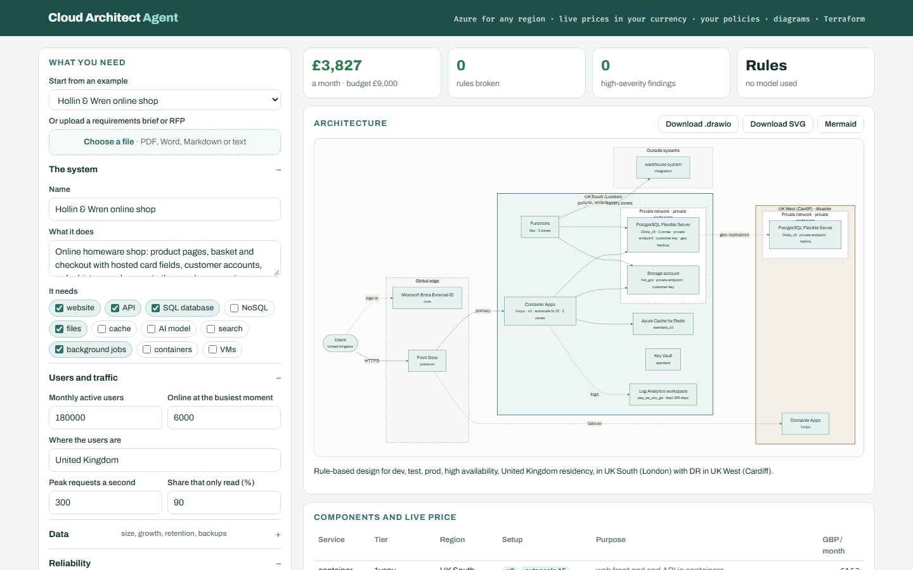

*Sarah's design. Top: £3,827 a month against her £9,000 budget, and no rules broken. Below: the map of the design,
with London as the main site, Cardiff as the backup site, and the private network that keeps customer data off the
internet.*

Sarah Collins is Head of Ecommerce at Hollin & Wren, an online homeware shop in the UK.

- **Before:** the shop runs on one ageing server in a back office, and it fell over on Black Friday, the busiest day
  of the year. Before the next one, Sarah needs a cloud plan that copes with 6,000 shoppers at once, keeps card
  payments safe enough to pass the card industry's security standard (PCI DSS), keeps customer data in the UK as the
  company's security standard says, and stays under the £9,000 a month the Finance Director will approve. An IT
  consultancy quoted three weeks to produce a first design.
- **With this project:** she uploads the company's security standard (a PDF). The tool lists the seven rules it found,
  each with the sentence it came from, and she ticks the ones to enforce. She fills in the shop's numbers: 180,000
  visitors a month, 6,000 at the peak, 120 GB of orders growing 25% a year, back online within an hour after a
  disaster, and dev, test and live copies. Then she presses **Design it**.
- **After:** in about a minute she has a design priced at £3,827 a month for all three copies, from today's price
  list, with nothing that breaks the policy: everything stays in London with a standby site in Cardiff, a web
  firewall in front of the shop, customer data on a private network and encrypted with the company's own keys, and
  logs kept for a year. She downloads the diagram for her IT supplier to edit, and the setup files to build it, on
  the same afternoon instead of after three weeks.

The same example, and three more from other countries, are in [`examples/`](examples/): a US telehealth start-up
under HIPAA (in US dollars), an Australian accounting firm with a Xero sync (in Australian dollars), and a German
manufacturer's supplier portal inside the EU (in euros).

## How you would use it

1. Open the web page (someone on your team starts it once; see [Getting started](#getting-started)).
2. Pick one of the examples under **Start from an example**, or upload a requirements brief (PDF, Word or text) and
   tick the values it found, or fill in the form yourself.
3. Choose where the data must stay and the currency for prices.
4. Under **Company policies**, upload your security or data policy and tick each rule you want enforced.
5. Press **Design it**.
6. Read the monthly total against your budget, the diagram, the price of each part, and any warnings with a plain fix.
7. Download the diagram (draw.io or SVG), the report and the setup files, and hand them to whoever will build it.

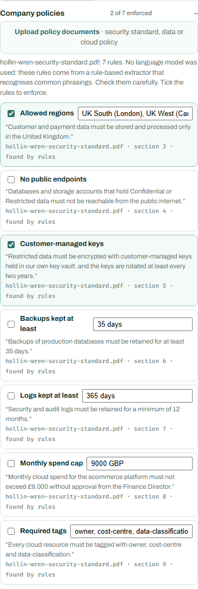

*Company policies. Each rule the tool found in the uploaded PDF, with the exact sentence and section it came from.
Only the ticked rules are enforced.*

## In technical terms

Cloud Architect Agent is an LLM agent (an AI model that can call tools and act on the results) and a rule-based
architect that design Azure architectures for any region. A workload described in business terms becomes an
architecture that is:

- **placed by data residency** (where the data is allowed to live): EU/EEA, UK, US, Canada, Australia, New Zealand or
  anywhere, in the allowed region nearest the users, with disaster recovery in the paired region;
- **priced live** from the public Azure Retail Prices API in any of 14 currencies, at Azure's own exchange rate;
- **checked** against hard constraints (residency, budget, coverage, stack constraints and every accepted company
  policy rule) and reviewed against more than 30 Well-Architected and compliance rules (Microsoft's checklist for
  reliable, secure and cost-effective designs, plus PCI DSS, HIPAA, GDPR, ISO 27001 and SOC 2 requirements);
- **delivered** as a Mermaid diagram, an editable draw.io file, an SVG picture, a markdown report and Terraform (code
  that builds the cloud resources) for `azurerm` v4.

It is for architects, platform teams and consultants who need a sound, costed first design they can defend.

## Key features

- **Any Azure region.** 43 regions with their pairs; jurisdictions map to allowed regions; the primary region follows
  the users and DR uses the paired region (or the nearest allowed one when the pair is restricted).
- **Prices in your currency.** USD, EUR, GBP, AUD, NZD, CAD and eight more, converted at Azure's own rate; dev and
  test environments are priced as smaller copies.
- **Every input changes the design or the checks:**
  - RTO and RPO decide between a warm standby, a database replica and geo-redundant backups;
  - growth sizes storage for 12 months and the database tier for 36;
  - peak concurrency sets autoscale; the read share decides whether a cache helps;
  - PCI DSS brings private networking, a web application firewall and a year of logs; HIPAA brings audit logs, six
    years of records and geo-redundant backups; GDPR flags personal data sent outside adequate countries;
  - integrations become queued background jobs; stack constraints such as "must use PostgreSQL" or "no Kubernetes"
    are enforced.
- **Company policies from documents.** Upload a PDF, Word, Markdown or text policy. A model (or, without one, a
  rule-based reader) proposes rules of eight kinds, each with its source, section and quote; you accept them, and
  violations cite the clause.
- **Requirements briefs.** Upload an RFP and confirm the values it proposes for the form.
- **Diagrams** for every design: Mermaid in the UI and report, an editable `.drawio` file using draw.io's own Azure
  shapes, and an SVG.
- **Terraform for `azurerm` v4** with zone redundancy, private endpoints, DR replicas and Front Door failover, plus the
  compliance settings: customer-managed keys, backup and log retention, audit diagnostics, record deletion, autoscale
  and required tags. Every evaluation and example design passes `terraform validate`.
- **Three ways in:** a web UI, a CLI, and an MCP server that any MCP-capable assistant or IDE can call.

## Architecture

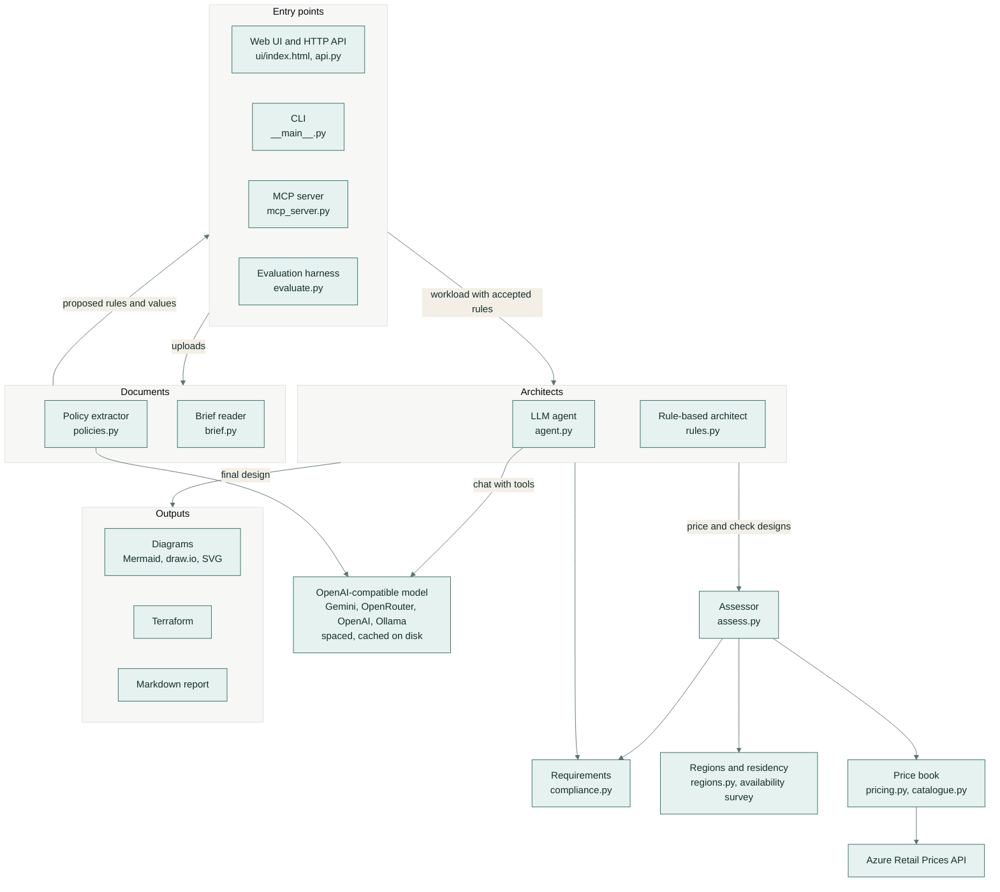

- **Documents** become proposed policy rules and form values. A person accepts them before they count.
- **Requirements** turn frameworks, recovery targets, policies and stack constraints into what a design must have.
  The rule-based architect builds to them; the assessor checks any design against them.
- **The assessor** prices each component live, checks the hard constraints, and runs the review. It judges the agent,
  the no-tools baseline and the rule-based architect alike.
- **Outputs**: the final design becomes diagrams, Terraform and a report.

The full reference, with every rule code and recipe, is in [docs/architecture.md](docs/architecture.md).

## How it works

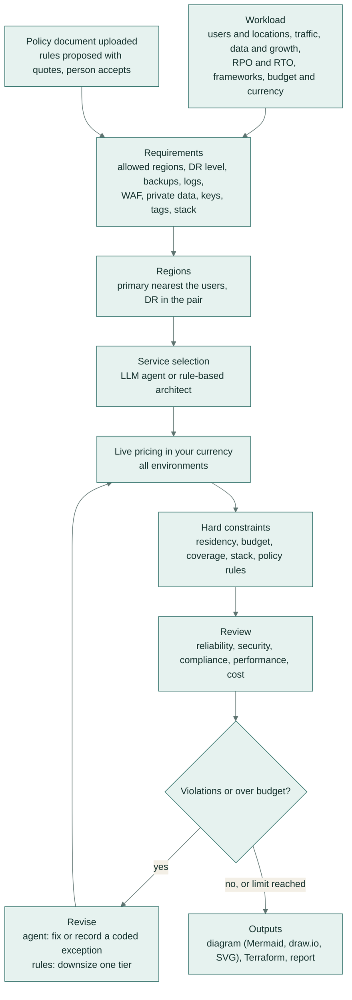

1. **Workload.** The form, a YAML file, the API or the MCP tool describes the needs; monthly and peak concurrent users
   and where they are; peak requests a second and the read share; database size and yearly growth, files, how long
   records and backups are kept; the uptime target, RPO (how much data you can afford to lose) and RTO (how long you
   can be down); frameworks and data types; sign-in; environments; integrations; stack constraints; and the budget
   with its currency.
2. **Policies.** An uploaded policy becomes proposed rules, each with its source, section and quote. Rules whose quote
   is not in the document are dropped. Only rules the person accepts are enforced.
3. **Requirements.** `compliance.py` works out what the design must provide, and why: for example an RTO of 60 minutes
   needs a warm standby in a second region, and PCI DSS needs a web application firewall (requirement 6.4.2).
4. **Regions.** The primary region is the allowed region nearest the users that sells every service needed (and has
   availability zones when high availability is asked for); DR goes to the paired region when allowed.
5. **Service selection.** The LLM agent (`agent.py`) chooses through tool calls; the rule-based architect
   (`rules.py`) builds to the requirements.
6. **Live pricing.** The price book fetches the exact meters from the Azure Retail Prices API (cached for a week),
   applies volume tiers, free grants and platform minimums, converts to your currency, and prices dev and test copies.
7. **Hard constraints and review.** The assessor checks residency, budget, coverage, stack constraints and every
   accepted policy rule, then runs the review. A residency, budget or policy violation can only be relaxed by an
   exception that names its rule code, and accepted exceptions are always shown.
8. **Revise.** The agent fixes what fails and resubmits (a submission that still has violations is sent back once).
   The rule-based architect downsizes one tier at a time until the design fits the budget and any spending cap.
9. **Outputs.** The final design becomes a diagram in three formats, Terraform, and a markdown report.

### The agent loop

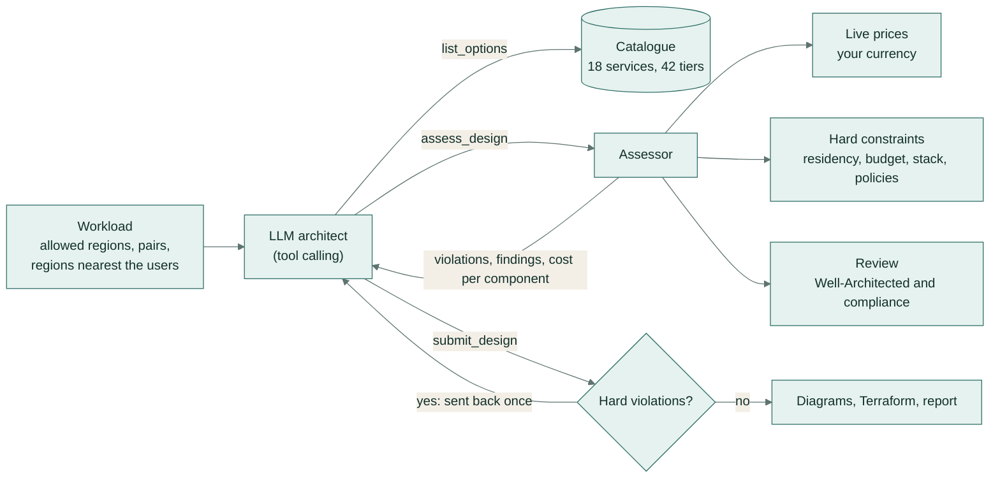

The agent is an OpenAI-compatible tool-calling loop of at most 12 steps. Calls are spaced (`AI_MIN_INTERVAL`), cached
on disk by request, and retried with back-off on rate limits; a used-up daily quota stops the run. The rule-based
architect steps in when no model is configured, when the agent returns no design, or when the model call fails (the UI
says so).

## Screenshots

**The price of every part.** Each component with its tier, region, setup (instances, autoscale, zones, private
network, customer-managed key) and monthly price in pounds, plus the dev and test copies and the exchange rate used.

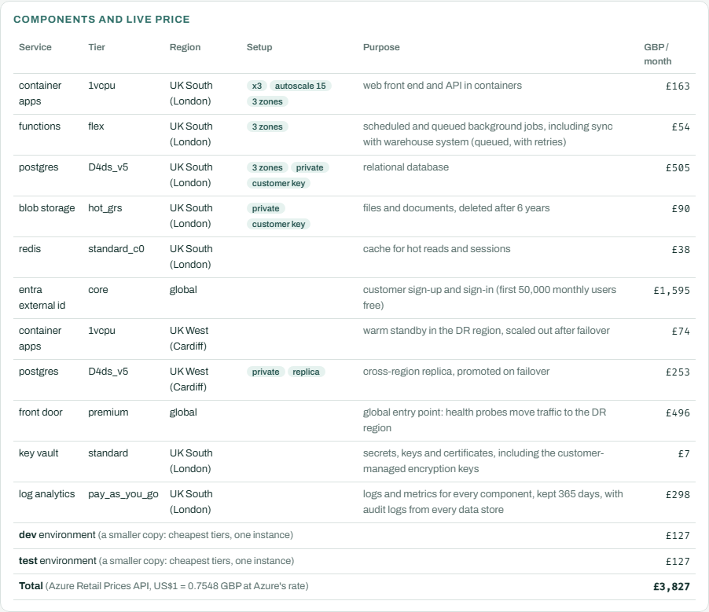

**What was checked, and why.** The review lists each finding with its fix and its source; the sizing card shows the
database now, in 12 months and in 36 months; and the enforced policy rules are listed with the sentence each came from.

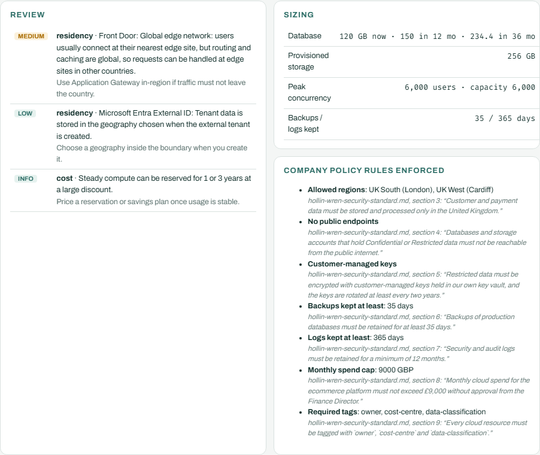

**The diagram as a file.** The same design exported as an SVG picture: London as primary with three availability
zones, Cardiff for disaster recovery, the private network with its private endpoints, the global edge, and the
warehouse sync. The `.drawio` download opens the same layout in draw.io with Azure icons, ready to edit.

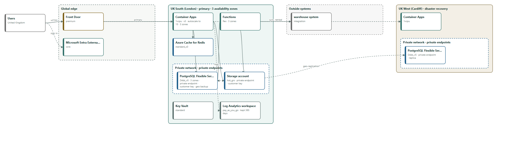

**A requirements brief, read for you.** Uploading the German manufacturer's RFP proposes each form value with the
sentence it came from; tick the ones to use.

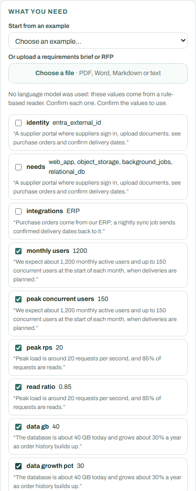

**The same tool in the EU, in euros.** The supplier portal designed from that brief: Germany West Central with
France Central for DR (Germany's paired region is restricted), SQL Server for the .NET team, €1,571 a month.

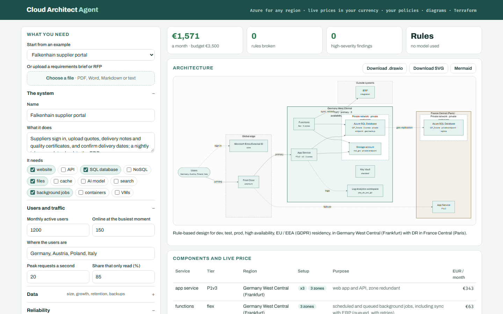

**From the command line.** Reading a policy without a model, and writing a design's report, diagrams and Terraform.

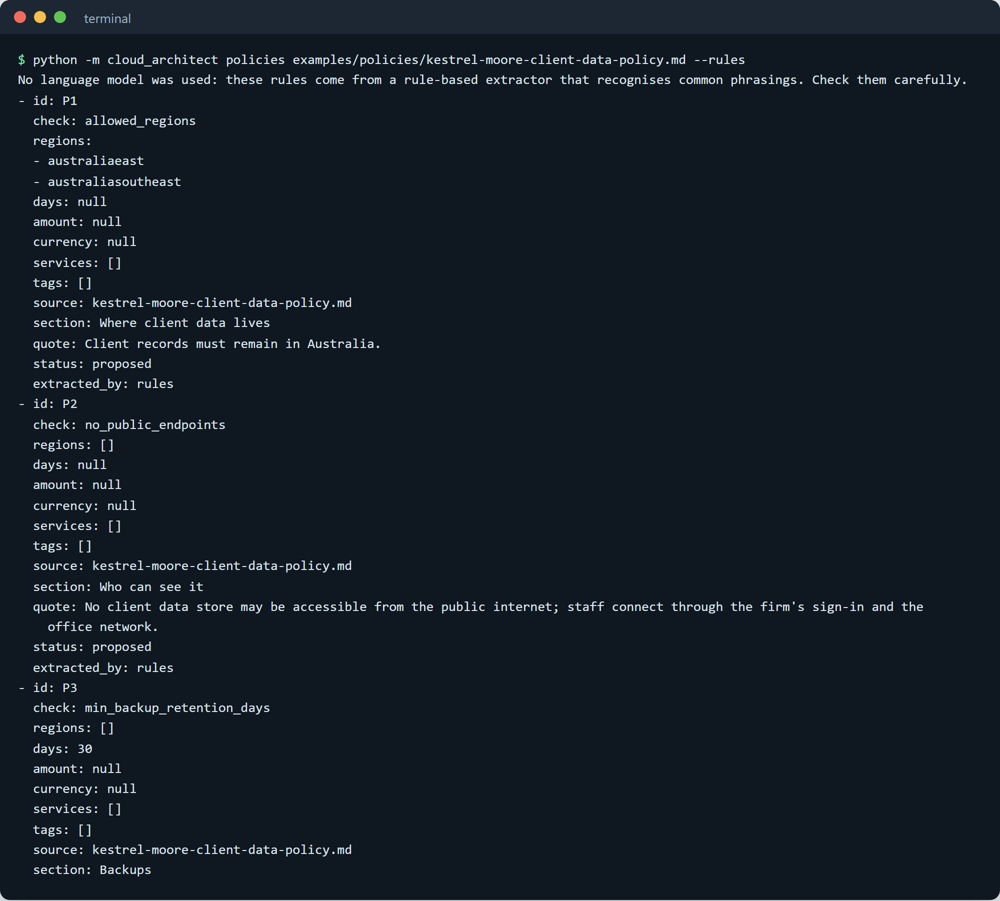

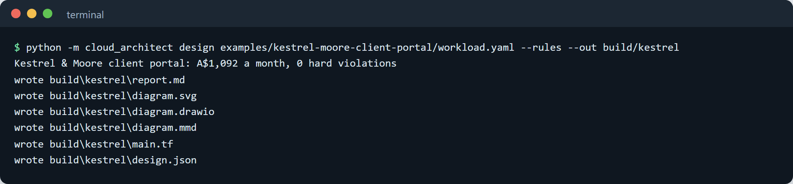

## The examples

| Example | Who and what | Rules in play | Design (rule-based) |
|---|---|---|---|
| [Hollin & Wren online shop](examples/hollin-wren-online-shop/) | Sarah, Head of Ecommerce: a UK homeware shop that fell over on Black Friday | UK only, PCI DSS, GDPR, RPO 15 min, RTO 60 min, 6,000 concurrent shoppers, a [security standard](examples/policies/hollin-wren-security-standard.md) with 7 rules | £3,827 a month (budget £9,000): UK South, DR in UK West |
| [Lumenvale virtual care](examples/lumenvale-telehealth/) | James, CTO of a US telehealth start-up with four engineers | US only, HIPAA, SOC 2, AI visit notes, 90-day backups, a [HIPAA policy](examples/policies/lumenvale-hipaa-security-policy.md) with an approved-services list | US$1,380 a month (budget US$7,000): East US 2, model in the US Data Zone |
| [Kestrel & Moore client portal](examples/kestrel-moore-client-portal/) | Emma, Practice Manager: client files off an office NAS, nightly Xero sync | Australia only, Privacy Act, records kept 7 years, a [client data policy](examples/policies/kestrel-moore-client-data-policy.md) with an A$2,500 cap | A$1,092 a month: Australia East |
| [Falkenhain supplier portal](examples/falkenhain-supplier-portal/) | Tom, IT Lead at a German parts manufacturer, from an [RFP](examples/briefs/falkenhain-supplier-portal-rfp.md) | EU only, GDPR, ISO 27001, RPO 15 min, RTO 4 h, .NET team | €1,571 a month (budget €3,500): Germany West Central, DR in France Central |

Each folder has the workload (`workload.yaml`, with the reviewed policy rules), the report (`report.md`), the
diagram (`diagram.drawio`, `diagram.svg`, `diagram.mmd`), the Terraform (`main.tf`) and the design (`design.json`).

## Tech stack

| Layer | Technology |
|---|---|
| Language | Python 3.10+ |
| Models and validation | Pydantic |
| LLM access | OpenAI Python SDK against any OpenAI-compatible endpoint (Google Gemini, OpenRouter, OpenAI, Azure OpenAI, Ollama, vLLM) |
| Documents | pypdf, python-docx |
| Web | FastAPI and Uvicorn; a single-page UI in HTML and JavaScript with Mermaid in the browser |
| MCP | FastMCP over stdio |
| Prices | Azure Retail Prices API, cached in SQLite |
| Infrastructure as code | Terraform with the `azurerm` (~> 4.0) and `random` providers |
| Diagrams | Mermaid, draw.io (built-in Azure shapes), SVG |
| Quality | pytest, httpx, Ruff, GitHub Actions |

## Getting started

### Prerequisites

- **Python 3.10 or newer.**
- **Terraform 1.6 or newer**, optional: for the `validate` and `fmt` tests and to deploy the generated code.
- **A model API key**, optional: for the AI agent and model-based document reading. Everything else (the rule-based
  architect, the rule-based readers, the MCP server and the price checks) needs no key and no Azure account.

### Install

```bash
git clone https://github.com/samiulhuda360/cloud-architect-agent
cd cloud-architect-agent
python -m venv .venv
source .venv/bin/activate          # Windows: .venv\Scripts\activate
pip install -e ".[dev]"            # the dev extra adds pytest, httpx and Ruff
```

### Configure

Copy `.env.example` to `.env` to use a model. Settings come from these environment variables or from `.env`:

| Variable | Description |
|---|---|
| `AI_API_KEY` | A Google Gemini key. On its own it selects Gemini's OpenAI-compatible endpoint and `gemini-flash-lite-latest`. |
| `AI_MODEL` | Another Gemini model |
| `AI_MIN_INTERVAL` | Seconds between model calls (default 2.5) |
| `LLM_BASE_URL`, `LLM_API_KEY`, `LLM_MODEL` | Any other OpenAI-compatible endpoint, key and model |
| `OPENROUTER_API_KEY` | A key for OpenRouter, the default endpoint when nothing else is set |
| `LLM_MAX_TOKENS` | Maximum tokens per model reply |
| `PRICE_CACHE` | The SQLite price cache (default `cache/prices.sqlite`) |
| `LLM_CACHE` | The model reply cache (default `cache/llm.sqlite`); `off` disables it |

For development and evaluation: `TERRAFORM` (path to `terraform`; turns on the validate and fmt tests),
`LIVE_PRICES=1` (runs the live price checks), `EVAL_PAUSE` (seconds between scenarios when evaluating a model).

### Run

```bash
python -m cloud_architect serve                # web UI and API on http://127.0.0.1:8000
```

## Usage

### Web UI

Open http://127.0.0.1:8000, then follow [How you would use it](#how-you-would-use-it). The form groups the inputs
into the system, users and traffic, data, reliability, security and compliance, team and integrations, and the
budget with its currency. The result has download buttons for the `.drawio`, SVG and Mermaid diagram, the report and
`main.tf`.

### Command line

| Command | What it does |
|---|---|
| `python -m cloud_architect design <file> [--rules] [--out <dir>] [--terraform <dir>]` | Designs a workload from YAML or JSON. `--out` writes `report.md`, `diagram.svg`, `diagram.drawio`, `diagram.mmd`, `main.tf` and `design.json`. |
| `python -m cloud_architect policies <document> [--rules]` | Proposes policy rules from a PDF, Word, Markdown or text document, as YAML to review |
| `python -m cloud_architect brief <document> [--rules]` | Proposes workload values from a requirements brief or RFP |
| `python -m cloud_architect serve [--port 8000]` | Starts the web UI and the HTTP API |
| `python -m cloud_architect mcp` | Starts the MCP server over stdio |
| `python -m cloud_architect eval [--only rules,agent,llm_only,extraction] [--resume] [--rescore] [--no-terraform]` | Runs the evaluation |

`design`, `policies` and `brief` use the model when one is configured, and the rule-based path otherwise or with
`--rules`.

A workload file (shortened from [examples/hollin-wren-online-shop/workload.yaml](examples/hollin-wren-online-shop/workload.yaml)):

```yaml
name: Hollin & Wren online shop
needs: [web_app, api, relational_db, object_storage, background_jobs]
monthly_users: 180000
peak_concurrent_users: 6000
user_locations: [United Kingdom]
peak_rps: 300
read_ratio: 0.9
data_gb: 120
data_growth_pct: 25
blob_gb: 800
retention_years: 6
backup_retention_days: 35
availability: high          # 99.95%
rpo_minutes: 15
rto_minutes: 60
residency: uk
frameworks: [pci_dss, gdpr]
identity: entra_external_id
environments: [dev, test, prod]
integrations: [warehouse system]
budget_month: 9000
currency: GBP
policies:                   # rules from the uploaded policy, reviewed and accepted
  - id: P1
    check: allowed_regions
    regions: [uksouth, ukwest]
    source: hollin-wren-security-standard.md
    section: '3'
    quote: Customer and payment data must be stored and processed only in the United Kingdom.
    status: accepted
```

Design it, then plan the generated Terraform:

```bash
python -m cloud_architect design examples/hollin-wren-online-shop/workload.yaml --rules --out build/shop
cd build/shop
terraform init
terraform plan -var subscription_id=<subscription-id> -var db_admin_password=<password> \
  -var 'required_tags={"owner":"<team>","cost-centre":"<code>","data-classification":"restricted"}'
```

The workload fields:

| Field | Meaning | Default |
|---|---|---|
| `name`, `description`, `needs` | What it is; needs are `web_app`, `api`, `relational_db`, `nosql_db`, `object_storage`, `cache`, `llm`, `search`, `background_jobs`, `containers`, `virtual_machines` | name and needs required |
| `monthly_users`, `peak_concurrent_users`, `user_locations` | Monthly active users, users online at the peak (default 5% of monthly), countries or regions they are in | 1,000, 5%, none |
| `peak_rps`, `read_ratio` | Peak requests a second, share that only read | 5, 0.8 |
| `data_gb`, `data_growth_pct`, `blob_gb` | Database GB today, growth % a year, files GB | 10, 0, 0 |
| `retention_years`, `backup_retention_days`, `geo_backup` | How long records and backups are kept; copy backups to a second region | 0, 7, false |
| `availability`, `rpo_minutes`, `rto_minutes` | `standard` (99.9%), `high` (99.95%) or `critical` (99.99%); recovery objectives in minutes | standard, none, none |
| `residency` | `eu`, `uk`, `us`, `canada`, `australia`, `nz` or `any` | `any` |
| `frameworks` | `gdpr`, `hipaa`, `pci_dss`, `iso27001`, `soc2` | none |
| `pii`, `health_data`, `card_data` | The kinds of sensitive data (HIPAA implies health data, PCI DSS card data) | false |
| `identity` | `entra_id` (staff), `entra_external_id` (customers), `external` or `none` | `none` |
| `environments` | Any of `dev`, `test`, `prod` | `[prod]` |
| `integrations`, `constraints` | Outside systems; stack constraints in plain words | none |
| `budget_month`, `currency` | Monthly budget and its currency (default: the jurisdiction's) | none |
| `preferred_region`, `policies` | A region to prefer; accepted company policy rules | none |
| `llm_input_mtokens`, `llm_output_mtokens` | Model tokens a month, in millions | 0 |

Older workload files with `budget_nzd_month` and `environment: dev` still load (as an NZD budget and a dev-only
environment).

### HTTP API

| Method and path | Body | Returns |
|---|---|---|
| `GET /api/presets` | | The four examples and the 20 evaluation workloads |
| `GET /api/options` | | The catalogue, regions, jurisdictions, currencies and policy check types |
| `POST /api/design` | `{"workload": {...}, "mode": "agent" or "rules"}` | Design, cost lines by environment, total, violations, findings, sizing, Mermaid, draw.io, SVG, Terraform and report |
| `POST /api/assess` | `{"workload": {...}, "design": {...}}` | The same for an edited design |
| `POST /api/policies/extract` | `{"filename": "...", "content_b64": "..."}` | Proposed policy rules, the method used and a note |
| `POST /api/brief/extract` | `{"filename": "...", "content_b64": "..."}` | Proposed workload values with their sentences |

FastAPI serves interactive docs at `/docs`.

### MCP server

`python -m cloud_architect mcp` starts a stdio MCP server; the client's own model does the designing.

| Tool | Returns |
|---|---|
| `list_services(role)` | The catalogue |
| `list_regions(jurisdiction)` | Jurisdictions with their regions and pairs |
| `check_region(service, region)` | Whether Azure sells a service in a region |
| `extract_policies(text, path, content_b64)` | Proposed policy rules with quotes |
| `extract_brief(text, path)` | Proposed workload values |
| `assess_design(workload, design)` | Price, hard constraints and review |
| `rule_based_design(workload)` | A rule-based design fitted to the budget |
| `diagram_for(workload, design, format)` | Mermaid or draw.io |
| `terraform_for(workload, design)` | Terraform |

```json
{
  "mcpServers": {
    "cloud-architect": { "command": "python", "args": ["-m", "cloud_architect", "mcp"], "cwd": "/path/to/cloud-architect-agent" }
  }
}
```

## Project structure

```
cloud_architect/
  __main__.py       CLI: design, policies, brief, eval, serve, mcp
  models.py         workload, policy rule, design and assessment models
  regions.py        43 regions, pairs, jurisdictions, currencies, region choice
  data/             availability.json: which tiers each region sells (from the live API)
  compliance.py     requirements from frameworks, recovery targets, policies and stack constraints
  catalogue.py      18 Azure services, 42 tiers and their exact price recipes
  pricing.py        Retail Prices API client, SQLite cache, tiered meters, currency conversion
  assess.py         pricing, hard constraints, the review and sizing (deterministic)
  rules.py          rule-based architect with budget-driven downsizing
  agent.py          tool-calling LLM agent and the LLM-only baseline
  llm.py            shared model client: spacing, retries, disk cache, daily-quota stop
  documents.py      PDF, Word, Markdown and text into sections and sentences
  policies.py       policy rules from documents (model with quote checks, or rules)
  brief.py          workload values from requirements briefs
  diagram.py        one graph model rendered as Mermaid, draw.io and SVG
  report.py         markdown report
  terraform.py      Terraform for azurerm v4, aligned like terraform fmt
  evaluate.py       evaluation harness for the architects and the extractors
  api.py            FastAPI app: web UI and JSON API
  mcp_server.py     MCP server (FastMCP, stdio)
  config.py         settings from environment variables and .env
ui/index.html       single-page web UI
examples/           four real-life examples, their policies and a requirements brief
eval/               20 scenarios, labelled policy documents, saved runs and results.md
docs/               architecture reference and screenshots
scripts/            refresh_availability.py, export_price_fixture.py
tests/              163 tests, an offline price fixture and live price checks
```

## Testing

```bash
pytest -q                                            # offline
TERRAFORM=terraform pytest -q                        # adds terraform validate and fmt
LIVE_PRICES=1 pytest -q tests/test_live_prices.py    # every price recipe against the live API
```

There are 163 tests: 161 run offline (with Terraform installed) against 719 real price rows captured from the API
(`tests/fixtures/prices.json`), and 2 check the live API. A scripted fake model stands in for the LLM, so CI never
calls a model. They cover:

- **Regions and currency:** the primary and DR region for nine jurisdiction and location cases (including a
  restricted pair), every jurisdiction enforced, the same design priced in six currencies at Azure's rate, older
  workload files.
- **Every input:** RTO to warm standby, RPO to a replica or geo backups, long backups to a backup vault or SQL LTR,
  growth to storage and tier, concurrency to autoscale, read share to a cache, user locations to an edge network,
  PCI, HIPAA, ISO and SOC 2 requirements, environments priced, customer sign-in priced past its free tier,
  integrations, stack constraints and record retention.
- **Policies:** PDF and Word reading, extraction of every labelled rule in the example policies, quote grounding for
  model rules, the fallback when the model fails, all eight check types enforced and cited, and the rule-based
  architect meeting all of them at once.
- **Outputs:** every example designs cleanly in its own currency, the diagram's regions, zones, private network and
  flows, the draw.io file's shapes and links, the report, and the compliance settings in the Terraform.
- **Core behaviour:** pricing recipes, residency and AI deployments, budget fitting, DR, the agent loop and its
  baseline, retries, the HTTP API, and Terraform that references only what it declares.

[CI](.github/workflows/ci.yml) runs `ruff check`, `ruff format --check` and `pytest -q` with Terraform installed on
every push, and the live price checks weekly.

## Evaluation

### Designs

[`eval/scenarios.yaml`](eval/scenarios.yaml) holds 20 workloads in six jurisdictions plus "anywhere", priced in six
currencies: for example a UK physiotherapy portal with health data, a Dutch HR assistant that needs a language model
inside the EU, a German bank chatbot at 99.99%, an Irish payments ledger with a 5-minute RPO, a US store under PCI
DSS with company policy rules, and a New Zealand portal that cannot leave the country. The same deterministic
assessor scores every design on: no silent violations (no hard constraint broken without an accepted exception),
within budget, the scenario's own expectations (for example the primary region near the users, DR in the paired
region, a WAF, a year of logs), high-severity findings left open, and `terraform validate`.

| System | Designs | No silent violations | Within budget | Expectations met | High findings left (avg) | Terraform valid | Own cost estimate within 20% |
|---|---|---|---|---|---|---|---|
| Rule-based architect (no model) | 20/20 | 20/20 | 20/20 | 20/20 | 0.05 | 20/20 | n/a |
| LLM agent with tools (Gemini Flash-Lite) | 20/20 | 20/20 | 20/20 | 13/20 | 0.30 | 20/20 | n/a |
| LLM alone, no tools (Gemini Flash-Lite) | 20/20 | 17/20 | 20/20 | 12/20 | 0.70 | 20/20 | 3/20 |

The model runs used `gemini-flash-lite-latest` on Gemini's free tier, on 14 October 2026.

- **The rule-based architect is the most reliable.** Its one open high finding is `REL-DR` on the New Zealand portal:
  New Zealand has one Azure region, so it records the regional-outage risk instead of leaving the country.
- **The tools stop silent rule breaks.** Every agent design passed residency, budget and coverage, because the
  assessor sends a failing submission back. Without tools, 3 of 20 designs used a service or tier that is not sold in
  the region they chose, and the model's own cost estimate was within 20% of the live price for only 3 of 20 (median
  error 63%).
- **The agent's misses are judgement calls**, each visible in the review: it put the Dutch assistant in Sweden
  Central for a Regional model, used a Global model deployment for the UK claims triage (with a recorded exception)
  where a Data Zone was expected, skipped the DR site for the German bank, chose PostgreSQL instead of SQL Server for
  the .NET team, sized the Australian store's database for today rather than its growth, and left out autoscale and
  background jobs on two more scenarios.

Scored designs are in [`eval/runs/`](eval/runs/) and per-scenario results in [`eval/results.md`](eval/results.md).

### Policy extraction

44 hand-labelled rules in 8 policy documents ([`eval/policy_labels.yaml`](eval/policy_labels.yaml)). A proposed rule
counts as correct only when its check type and its parameters (regions, days, amount and currency, services or tags)
match a label. The five development documents (the three example policies and two more in other styles) were used
while building the rule-based reader; the three held-out documents were written and labelled after it was finished
and never used to change it.

| Extractor | Documents | Labelled | Proposed | Correct | Precision | Recall |
|---|---|---|---|---|---|---|
| Model (Gemini Flash-Lite) | development | 27 | 27 | 27 | 100% | 100% |
| Model (Gemini Flash-Lite) | held-out | 17 | 17 | 17 | 100% | 100% |
| Rule-based reader (no model) | development | 27 | 27 | 27 | 100% | 100% |
| Rule-based reader (no model) | held-out | 17 | 7 | 6 | 86% | 35% |

All of the model's quotes were found in their documents, so none was dropped. The rule-based reader is precise but
only recognises phrasings it was built for, which is why the UI says when no model was used and asks the person to
check the list. With 44 rules, these numbers are a sanity check, not a benchmark.

```bash
python -m cloud_architect eval --only rules,extraction     # no model needed for the rule-based rows
AI_API_KEY=... python -m cloud_architect eval              # all systems, model rows included
python -m cloud_architect eval --rescore                   # re-score saved runs without calling a model
```

Model replies are cached on disk and the runs are saved, so re-scoring never calls a model. `--resume` re-runs only
the scenarios that failed with a provider error.

## Scope

- **List prices.** Reservations, savings plans and enterprise discounts are not applied (the review flags where a
  reservation would pay off). Requests, egress, log volume and long-term backup storage are estimated from the
  workload.
- **A curated catalogue** of 18 services and their common tiers, not every Azure SKU. Concurrency per instance is a
  rule of thumb.
- **Compliance support, not certification.** The framework checks cover what an architecture can show (network
  isolation, firewalls, encryption keys, retention, audit logs, separation of environments, data location). They do
  not replace an assessor, a privacy review or Microsoft's own compliance documentation.
- **Terraform is a reviewed starting point**, validated but not deployed: no remote state, application code or
  pipelines, and Entra External ID tenants are created in the Entra admin center.

## Licence

MIT, see [LICENSE](LICENSE). Prices come from Microsoft's public Azure Retail Prices API. This project is not
affiliated with Microsoft.
