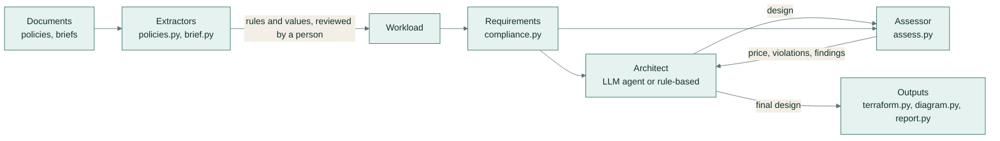

# How Cloud Architect Agent works

This is the reference for anyone reviewing or extending the code. The README covers what the project does and why.

## 1. Regions, residency and currency (`regions.py`)

**Regions.** 43 Azure regions with their city, country, geography, paired region and whether access is restricted to
in-country customers (France South, Germany North, Norway West, Sweden South, Switzerland West). Restricted regions are
never chosen automatically.

**Jurisdictions.** Each maps to the regions data may live in, and to a default currency:

| Jurisdiction | Regions | Default currency |
|---|---|---|
| `eu` | the EU and EEA regions (West and North Europe, France, Germany, Sweden, Norway, Italy, Spain, Poland) | EUR |
| `uk` | UK South, UK West | GBP |
| `us` | East US, East US 2, Central US, North/South/West Central US, West US 1-3 | USD |
| `canada` | Canada Central, Canada East | CAD |
| `australia` | Australia East, Australia Southeast | AUD |
| `nz` | New Zealand North | NZD |
| `anz` | New Zealand North plus Australia (kept for older workload files) | NZD |
| `any` | every unrestricted region | USD |

Accepted `allowed_regions` policy rules narrow the set further.

**Choosing the primary region.** In order: the preferred region, the region nearest each user location (`"Germany"` →
Germany West Central, `"Texas"` → South Central US, `"Ireland"` → North Europe), the jurisdiction's default, then the
rest of the jurisdiction nearest first. The first candidate inside the boundary that sells every service the workload
needs wins. A high-availability workload also needs availability zones, so its region must sell zone-redundant storage.

**Choosing the DR region.** The paired region when it is inside the boundary, open to everyone and sells the
services; otherwise the nearest allowed region (same country, then same geography). Germany West Central's pair is
restricted, so a German workload fails over to France Central. New Zealand North has no pair, so under `nz` residency
there is no DR region and the design records the regional-outage risk.

**Service availability.** `scripts/refresh_availability.py` prices every catalogue tier in every region through the
live Retail Prices API and writes `cloud_architect/data/availability.json` (surveyed 14 October 2026). Azure publishes
a retail price for everything it sells in a region, so no price means not sold. The survey shows, for example, that UK
West and Australia Southeast have no availability zones, that New Zealand North sells no GRS storage and no language
model, and that a Data Zone model deployment is sold in the EU and US regions but not in UK South or Canada.

**Currency.** Prices are fetched in USD and converted at Azure's own rate, derived from a large reference VM (Linux
D64s v5 in East US 2) priced in both currencies, so the four-decimal rounding of the API is negligible. On 14 October
2026: US$1 = £0.7548 = €0.88 = A$1.4246 = NZ$1.7666 = C$1.4165. Fourteen currencies are supported.

## 2. Pricing (`pricing.py`, `catalogue.py`)

**Source.** The [Azure Retail Prices API](https://learn.microsoft.com/rest/api/cost-management/retail-prices/azure-retail-prices)
is public, so no Azure account is needed. The client follows `NextPageLink`, retries failures with back-off, and caches
each query in SQLite (`cache/prices.sqlite`) for a week.

**Catalogue.** 18 services and 42 tiers. Each tier is a list of `Usage` recipes:

| Field | Meaning |
|---|---|
| `match` | the exact product, SKU and meter |
| `quantity(component, workload)` | monthly units: hours, GB-months, 10K requests, GB-seconds, monthly active users, … |
| `free` | a monthly free grant, subtracted once (some regions publish it as a $0 band instead) |
| `service`, `extra`, `region` | price from another API service, or a fixed or derived pricing region (Front Door bills by the edge zone of the users' region; Entra External ID is priced globally) |

Recipes added for the workload inputs: Log Analytics interactive retention beyond 31 days and long-term retention
beyond 90 days; Key Vault automated key rotation for customer-managed keys; Azure SQL long-term backup storage; Azure
Backup protected PostgreSQL servers and vault storage (one weekly full backup kept for the retention period); Entra
External ID monthly active users past the free 50,000; Regional Standard model deployments.

**Sizing from the workload.** PostgreSQL storage is provisioned for the database size in 12 months (growth compounded)
with 50% headroom, rounded up to a size Azure sells. Dev and test environments are priced as smaller copies of the
production design: primary region only, the cheapest tier of each service, one instance, small data.

**One price per band.** `catalogue.ambiguous_recipes()` checks that every recipe resolves to exactly one price per volume
band, offline in the tests and weekly in CI against the live API.

## 3. Requirements (`compliance.py`)

One function turns the workload into what the design must provide. The rule-based architect builds to it and the
assessor checks any design against it, and every requirement keeps its reasons so findings can cite them.

| Input | Requirement |
|---|---|
| Availability 99.99%, or RTO ≤ 240 minutes | a warm standby in the DR region: compute, a database replica, and Front Door to switch traffic |
| RPO < 60 minutes | a database replica in the DR region |
| RPO ≤ 24 hours, "copy backups to a second region", or HIPAA | geo-redundant backups (and GRS storage where the region has a pair) |
| Backups kept more than 35 days | long-term retention: a backup vault for PostgreSQL, a weekly LTR policy for Azure SQL |
| PCI DSS | private endpoints on data stores (req. 1.3), a WAF (req. 6.4.2), logs kept 365 days (req. 10.5.1), audit logs |
| HIPAA | private endpoints (164.312(e)(1)), audit logs (164.312(b)), records kept six years (164.316(b)(2)), geo backups (164.308(a)(7)) |
| SOC 2 | logs kept 365 days (CC7.2), a separate test environment (CC8.1) |
| ISO 27001 | audit logs (A.8.15), a separate test environment (A.8.31) |
| GDPR | personal data only in the EEA or adequate countries (Chapter V), a retention period (art. 5(1)(e)) |
| Personal data in production | private endpoints; a WAF for a public web app |
| Stack constraints | `must use PostgreSQL` → required, `no Kubernetes` → forbidden, `.NET team` → Azure SQL preferred |
| Accepted policy rules | allowed regions, customer-managed keys, private data stores, backup and log retention, approved services, a spending cap, required tags |

## 4. Company policies and briefs (`documents.py`, `policies.py`, `brief.py`)

**Reading.** PDF (pypdf), Word (python-docx, with heading styles kept as sections), Markdown and text become sentences
tagged with their section. A sentence that ends with a colon collects the list after it, so "only the following
services are approved:" keeps its list.

**Policy rules.** Eight check types: `allowed_regions`, `customer_managed_keys`, `no_public_endpoints`,
`min_backup_retention_days`, `approved_services`, `max_monthly_spend`, `required_tags`, `min_log_retention_days`.
Every rule records its source document, section and the sentence that states it.

- **With a model**, the document goes to the model with the check types and their parameters. Places become Azure
  regions, service names become catalogue ids, and any rule whose quote is not in the document is dropped, so nothing
  is enforced on an invented clause.
- **Without a model**, a rule-based extractor reads sentences that state an obligation (must, shall, only, may not,
  …) and recognises common phrasings for each check type. The UI and the API say which method was used.
- **Review.** Every rule comes back `proposed`. The person ticks the rules to enforce, and can edit days, amounts and
  tags. Only `accepted` rules are checked.

**Requirements briefs.** The same reading proposes form values (users, concurrency, data size and growth, retention,
RPO, RTO, frameworks, locations, integrations, constraints, budget and currency), each with its sentence. The person
confirms each value before it fills the form.

## 5. Assessment (`assess.py`)

The assessor is deterministic: the same design, workload and prices always get the same verdict.

### Hard constraints (violations)

An entry in `accepted_exceptions` that names the rule code (for example `"[RES-REGION] …"`) or the thing it relaxes
turns a residency, budget, stack or policy violation into a high-severity finding marked `Accepted:`. Coverage
violations cannot be accepted.

| Code | Fails when |
|---|---|
| `UNKNOWN`, `REGION`, `NOT-SOLD`, `NEED` | the service, tier or region is unknown, Azure doesn't sell it there, or a need is not covered |
| `RES-REGION`, `RES-DR` | a component or the DR region is outside the jurisdiction |
| `RES-AI-GLOBAL` | a Global model deployment with personal data or a residency boundary |
| `RES-AI-ZONE` | a Data Zone deployment whose zone (EU or US) is not the jurisdiction; a medium finding for Australia |
| `BUDGET` | the monthly total, all environments included, is over budget |
| `STACK-MUST`, `STACK-FORBID` | a required service is missing or a ruled-out one is used |
| `POL-REGION`, `POL-CMK`, `POL-PUBLIC`, `POL-BACKUP`, `POL-SERVICE`, `POL-SPEND`, `POL-TAGS`, `POL-LOGS` | an accepted policy rule is broken; the violation cites the clause |

### Review (findings)

| Pillar | Codes |
|---|---|
| reliability | `REL-ZONES`, `REL-DB-HA`, `REL-DR`, `REL-FAILOVER`, `REL-GEO-BACKUP`, `REL-BACKUP`, `REL-STORAGE`, `REL-TIER`, `REL-ZR-TIER`, `REL-ZR-REGION` |
| security | `SEC-PRIVATE`, `SEC-SECRETS`, `SEC-WAF`, `SEC-IDENTITY` |
| compliance | `COMP-GDPR-TRANSFER`, `COMP-LOGS`, `COMP-AUDIT`, `COMP-TEST-ENV`, `COMP-RETENTION`, `COMP-BAA` |
| performance | `PERF-CACHE` (read share ≥ 50%), `PERF-INSTANCES`, `PERF-SESSIONS`, `PERF-EDGE`, `PERF-CAPACITY` (36-month size past a tier limit) |
| operations | `OPS-LOGS`, `OPS-INTEGRATION`, `OPS-GROWTH`, `STACK-PREFER` |
| cost and residency | `COST-DEV`, `COST-RESERVE`, `RES-EDGE`, `RES-GLOBAL`, `RES-IDP` |

`PERF-INSTANCES` uses a rule of thumb for concurrent users per instance (for example 800 on App Service P1v3, 400 per
1-vCPU Container Apps replica) at the autoscale maximum.

The assessment also returns sizing: the database now, in 12 and in 36 months, provisioned storage, peak concurrency
against capacity, and the backup and log retention the design keeps.

## 6. The architects

### Rule-based (`rules.py`)

It builds to the requirements: the region and DR region above; App Service, Container Apps or AKS by the needs and
stack constraints, with autoscale sized from peak concurrency; PostgreSQL or Azure SQL sized from 36-month growth
and write load; Cosmos DB, storage (GRS, ZRS or LRS), a cache for read-heavy traffic or shared sessions; Functions for
background jobs and integrations; a language model in the jurisdiction when Azure sells one there (a Data Zone or
Regional deployment), otherwise in the nearest Data Zone with a coded exception; Entra External ID for customer
sign-in; Front Door Premium or Application Gateway WAF; Key Vault (with the customer-managed key) and Log Analytics
(with retention and audit settings); and the tags a policy requires. An approved-services rule leaves out optional
extras it does not list. The design is then downsized tier by tier until it fits the budget and any spending cap.

### LLM agent (`agent.py`, `llm.py`)

An OpenAI-compatible tool-calling loop (at most 12 steps) with `list_options`, `assess_design` and `submit_design`.
The context lists the allowed regions, their pairs and the regions nearest the users; the system prompt gives the
recovery, compliance and policy rules. A submission with hard violations is sent back once. Calls are spaced
(`AI_MIN_INTERVAL`, 2.5 seconds by default), cached on disk by request, and retried with back-off; a used-up daily
quota stops the run instead of retrying.

### LLM without tools (the baseline)

The same rules, context and catalogue, but no tools: it estimates the price itself. One repair turn for an
unparseable reply.

## 7. Outputs

**Diagrams (`diagram.py`).** One graph model, rendered three ways:

- **Mermaid** for the UI and the report: users and where they are, identity, the global edge, one box per region
  marked primary, disaster recovery and availability zones, a private-network box with the private endpoints, outside
  systems, and edges for traffic, sign-in, prompts, geo-replication, backups, logs and integration syncs. A region
  outside the residency boundary is drawn in red.
- **draw.io** (`.drawio`): the same layout with draw.io's built-in Azure shapes, referenced by stencil path
  (`img/lib/azure2/...`), so the file opens and edits in draw.io with no icon files bundled here.
- **SVG**: a self-contained picture of the same layout for the report.

**Report (`report.py`).** Markdown with the cost by environment, the diagram, components and prices, sizing, the
enforced policy rules with their quotes, and every check.

**Terraform (`terraform.py`).** One resource group; each component with its tier, zone redundancy and instances;
virtual networks only where needed; private endpoints with private DNS; App Service VNet integration; database replicas
and Front Door priority failover for DR. Compliance settings from the design:

- customer-managed keys: a user-assigned identity, a rotating RSA key, and the key wired into PostgreSQL, Azure SQL
  (TDE), Cosmos DB and storage; with geo-redundant backup, a second key vault and key in the paired region;
- backups: retention days, geo-redundant backup, storage auto-grow when the data grows, an Azure SQL weekly LTR
  policy, and a Data Protection backup vault, policy and instance for long PostgreSQL retention;
- logs: interactive retention up to 90 days and total retention on the workspace table, in the steps Azure accepts;
- audit: a diagnostic setting on every data store and Key Vault;
- records: a storage lifecycle rule that deletes files after the retention period;
- autoscale for App Service up to the instance count peak concurrency needs;
- tags on every resource that takes them, with required tags as an input variable that must be set.

Secrets are variables, apps use managed identities, and no storage key appears. `_fmt` aligns attributes the way
`terraform fmt` does. With Terraform installed, the tests run a `fmt` round-trip on all 20 scenario designs and
`validate` on a multi-region design; the evaluation validates every design it scores, and the four examples.
