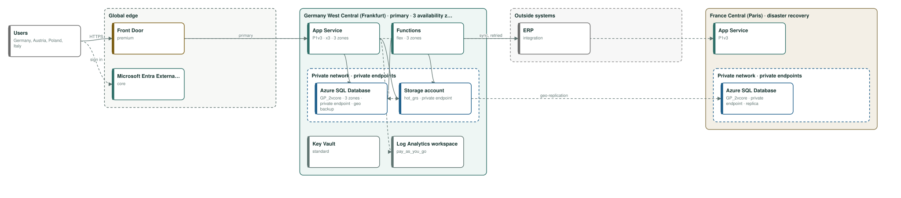
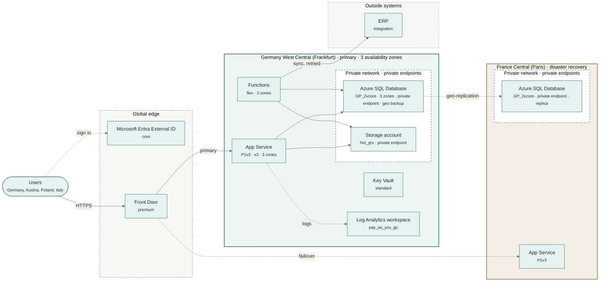

# Falkenhain supplier portal

Suppliers sign in, upload quotes, delivery notes and quality certificates, and confirm delivery dates; a nightly job syncs dates back to the ERP.

| | |
|---|---|
| Monthly cost | **€1,571** (budget €3,500) |
| By environment | dev €30, test €30, prod €1,510 |
| Region | Germany West Central (Frankfurt), disaster recovery in France Central (Paris) |
| Data residency | EU / EEA (GDPR) |
| Availability target | 99.95%, RPO 15 min, RTO 240 min |
| Frameworks | GDPR, ISO27001 |
| Hard violations | 0 |

## Architecture

Rule-based design for dev, test, prod, high availability, EU / EEA (GDPR) residency, in Germany West Central (Frankfurt) with DR in France Central (Paris).

## Components and monthly price

Prices from the Azure Retail Prices API in EUR (US$1 = 0.88 EUR at Azure's rate).

| Service | Tier | Region | Purpose | EUR / month |
|---|---|---|---|---:|
| App Service (Linux) | P1v3 | Germany West Central (Frankfurt) | web app and API, zone redundant | €343 |
| Functions (Flex Consumption) | flex | Germany West Central (Frankfurt) | scheduled and queued background jobs, including sync with ERP (queued, with retries) | €63 |
| Azure SQL Database | GP_2vcore | Germany West Central (Frankfurt) | relational database (SQL Server engine) | €354 |
| Storage account (Blob) | hot_grs | Germany West Central (Frankfurt) | files and documents, deleted after 10 years | €60 |
| Microsoft Entra External ID | core | global | customer sign-up and sign-in (first 50,000 monthly users free) | €0 |
| App Service (Linux) | P1v3 | France Central (Paris) | warm standby in the DR region, scaled out after failover | €112 |
| Azure SQL Database | GP_2vcore | France Central (Paris) | cross-region replica, promoted on failover | €254 |
| Front Door | premium | global | global entry point: health probes move traffic to the DR region | €311 |
| Key Vault | standard | Germany West Central (Frankfurt) | secrets, keys and certificates | €2 |
| Log Analytics workspace | pay_as_you_go | Germany West Central (Frankfurt) | logs and metrics for every component, with audit logs from every data store | €13 |
| dev environment | smaller copy | Germany West Central (Frankfurt) | cheapest tiers, one instance | €30 |
| test environment | smaller copy | Germany West Central (Frankfurt) | cheapest tiers, one instance | €30 |
| **Total** | | | | **€1,571** |

## Sizing

- Database: 40 GB today, 52 GB in 12 months, 88 GB in 36 months at 30% a year.
- Peak concurrency: 150.0 users; the web tier serves about 2,400.0 at full scale-out.
- Backups kept 35 days; logs kept 30 days.

## Checks

- No hard violations: residency, budget, coverage, stack and every accepted policy rule hold.
- medium · residency · **RES-EDGE**: Front Door: Global edge network: users usually connect at their nearest edge site, but routing and caching are global, so requests can be handled at edge sites in other countries. Fix: Use Application Gateway in-region if traffic must not leave the country.
- low · residency · **RES-GLOBAL**: Microsoft Entra External ID: Tenant data is stored in the geography chosen when the external tenant is created. Fix: Choose a geography inside the boundary when you create it.
- info · cost · **COST-RESERVE**: Steady compute can be reserved for 1 or 3 years at a large discount. Fix: Price a reservation or savings plan once usage is stable.
