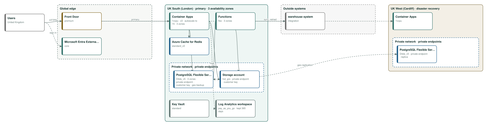
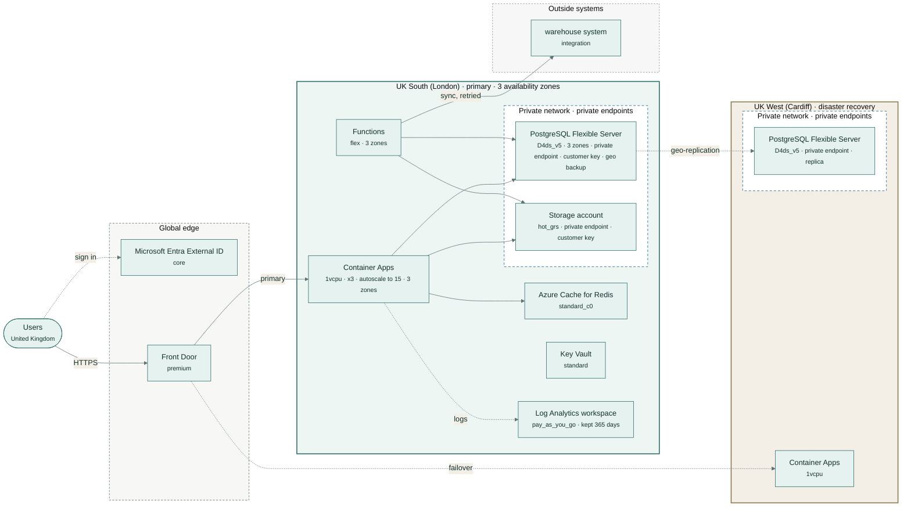

# Hollin & Wren online shop

Online homeware shop: product pages, basket and checkout with hosted card fields, customer accounts, order history, and a sync to the warehouse system.

| | |
|---|---|
| Monthly cost | **£3,827** (budget £9,000) |
| By environment | dev £127, test £127, prod £3,574 |
| Region | UK South (London), disaster recovery in UK West (Cardiff) |
| Data residency | United Kingdom |
| Availability target | 99.95%, RPO 15 min, RTO 60 min |
| Frameworks | PCI DSS, GDPR |
| Hard violations | 0 |

## Architecture

Rule-based design for dev, test, prod, high availability, United Kingdom residency, in UK South (London) with DR in UK West (Cardiff).

## Components and monthly price

Prices from the Azure Retail Prices API in GBP (US$1 = 0.7548 GBP at Azure's rate).

| Service | Tier | Region | Purpose | GBP / month |
|---|---|---|---|---:|
| Container Apps | 1vcpu | UK South (London) | web front end and API in containers | £163 |
| Functions (Flex Consumption) | flex | UK South (London) | scheduled and queued background jobs, including sync with warehouse system (queued, with retries) | £54 |
| PostgreSQL Flexible Server | D4ds_v5 | UK South (London) | relational database | £505 |
| Storage account (Blob) | hot_grs | UK South (London) | files and documents, deleted after 6 years | £90 |
| Azure Cache for Redis | standard_c0 | UK South (London) | cache for hot reads and sessions | £38 |
| Microsoft Entra External ID | core | global | customer sign-up and sign-in (first 50,000 monthly users free) | £1,595 |
| Container Apps | 1vcpu | UK West (Cardiff) | warm standby in the DR region, scaled out after failover | £74 |
| PostgreSQL Flexible Server | D4ds_v5 | UK West (Cardiff) | cross-region replica, promoted on failover | £253 |
| Front Door | premium | global | global entry point: health probes move traffic to the DR region | £496 |
| Key Vault | standard | UK South (London) | secrets, keys and certificates, including the customer-managed encryption keys | £14 |
| Log Analytics workspace | pay_as_you_go | UK South (London) | logs and metrics for every component, kept 365 days, with audit logs from every data store | £298 |
| dev environment | smaller copy | UK South (London) | cheapest tiers, one instance | £127 |
| test environment | smaller copy | UK South (London) | cheapest tiers, one instance | £127 |
| **Total** | | | | **£3,827** |

## Sizing

- Database: 120 GB today, 150 GB in 12 months, 234 GB in 36 months at 25% a year; 256 GB provisioned.
- Peak concurrency: 6,000.0 users; the web tier serves about 6,000.0 at full scale-out.
- Backups kept 35 days; logs kept 365 days.

## Company policy rules enforced

- **allowed regions** (P1): hollin-wren-security-standard.md, section 3: "Customer and payment data must be stored and processed only in the United Kingdom."
- **no public endpoints** (P2): hollin-wren-security-standard.md, section 4: "Databases and storage accounts that hold Confidential or Restricted data must not be reachable from the public internet."
- **customer managed keys** (P3): hollin-wren-security-standard.md, section 5: "Restricted data must be encrypted with customer-managed keys held in our own key vault, and the keys are rotated at least every two years."
- **min backup retention days** (P4): hollin-wren-security-standard.md, section 6: "Backups of production databases must be retained for at least 35 days."
- **min log retention days** (P5): hollin-wren-security-standard.md, section 7: "Security and audit logs must be retained for a minimum of 12 months."
- **max monthly spend** (P6): hollin-wren-security-standard.md, section 8: "Monthly cloud spend for the ecommerce platform must not exceed £9,000 without approval from the Finance Director."
- **required tags** (P7): hollin-wren-security-standard.md, section 9: "Every cloud resource must be tagged with `owner`, `cost-centre` and `data-classification`."

## Checks

- No hard violations: residency, budget, coverage, stack and every accepted policy rule hold.
- medium · residency · **RES-EDGE**: Front Door: Global edge network: users usually connect at their nearest edge site, but routing and caching are global, so requests can be handled at edge sites in other countries. Fix: Use Application Gateway in-region if traffic must not leave the country.
- low · residency · **RES-GLOBAL**: Microsoft Entra External ID: Tenant data is stored in the geography chosen when the external tenant is created. Fix: Choose a geography inside the boundary when you create it.
- info · cost · **COST-RESERVE**: Steady compute can be reserved for 1 or 3 years at a large discount. Fix: Price a reservation or savings plan once usage is stable.
