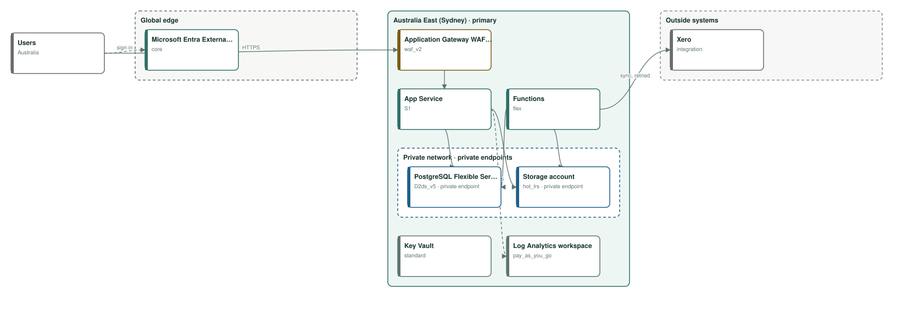
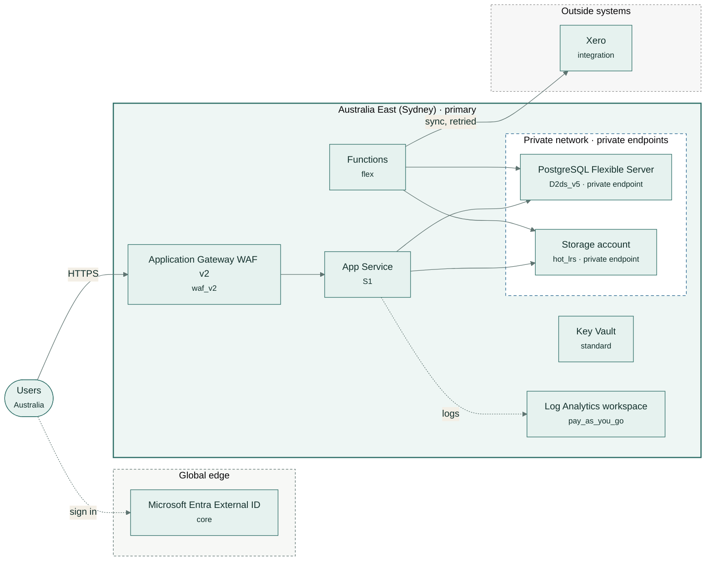

# Kestrel & Moore client portal

Clients upload and download tax documents and sign engagement letters; staff manage files by client.

| | |
|---|---|
| Monthly cost | **A$1,092** (budget A$2,500) |
| By environment | test A$58, prod A$1,034 |
| Region | Australia East (Sydney) |
| Data residency | Australia |
| Availability target | 99.9% |
| Frameworks | none |
| Hard violations | 0 |

## Architecture

Rule-based design for test, prod, standard availability, Australia residency, in Australia East (Sydney).

## Components and monthly price

Prices from the Azure Retail Prices API in AUD (US$1 = 1.4246 AUD at Azure's rate).

| Service | Tier | Region | Purpose | AUD / month |
|---|---|---|---|---:|
| App Service (Linux) | S1 | Australia East (Sydney) | web app and API | A$125 |
| Functions (Flex Consumption) | flex | Australia East (Sydney) | scheduled and queued background jobs, including sync with Xero (queued, with retries) | A$48 |
| PostgreSQL Flexible Server | D2ds_v5 | Australia East (Sydney) | relational database | A$260 |
| Storage account (Blob) | hot_lrs | Australia East (Sydney) | files and documents, deleted after 7 years | A$33 |
| Microsoft Entra External ID | core | global | customer sign-up and sign-in (first 50,000 monthly users free) | A$0 |
| Application Gateway WAF v2 | waf_v2 | Australia East (Sydney) | web application firewall in front of the app | A$573 |
| Key Vault | standard | Australia East (Sydney) | secrets, keys and certificates | A$1 |
| Log Analytics workspace | pay_as_you_go | Australia East (Sydney) | logs and metrics for every component | A$0 |
| test environment | smaller copy | Australia East (Sydney) | cheapest tiers, one instance | A$58 |
| **Total** | | | | **A$1,092** |

## Sizing

- Database: 8 GB today, 9 GB in 12 months, 12 GB in 36 months at 15% a year; 32 GB provisioned.
- Peak concurrency: 120.0 users; the web tier serves about 250.0 at full scale-out.
- Backups kept 30 days; logs kept 30 days.

## Company policy rules enforced

- **allowed regions** (P1): kestrel-moore-client-data-policy.md, section Where client data lives: "Client records must remain in Australia."
- **no public endpoints** (P2): kestrel-moore-client-data-policy.md, section Who can see it: "No client data store may be accessible from the public internet; staff connect through the firm's sign-in and the office network."
- **min backup retention days** (P3): kestrel-moore-client-data-policy.md, section Backups: "Backups must be retained for 30 days, and one restore is tested each month."
- **max monthly spend** (P4): kestrel-moore-client-data-policy.md, section Costs: "The monthly IT hosting cost must stay under A$2,500 including all environments."

## Checks

- No hard violations: residency, budget, coverage, stack and every accepted policy rule hold.
- low · residency · **RES-GLOBAL**: Microsoft Entra External ID: Tenant data is stored in the geography chosen when the external tenant is created. Fix: Choose a geography inside the boundary when you create it.
- info · cost · **COST-RESERVE**: Steady compute can be reserved for 1 or 3 years at a large discount. Fix: Price a reservation or savings plan once usage is stable.
