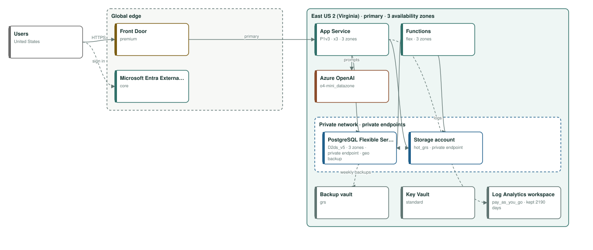
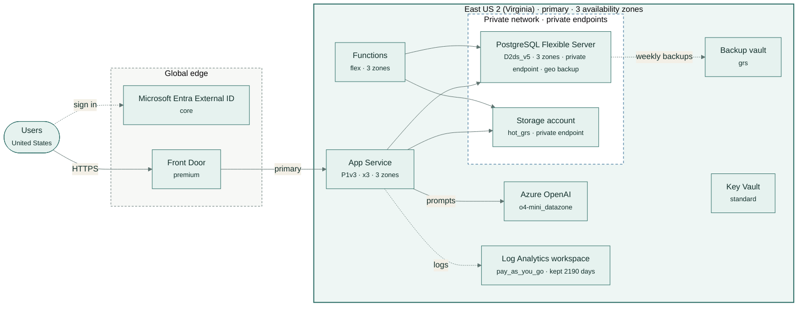

# Lumenvale virtual care platform

Patients book and join video visits and see their records; clinicians get AI-drafted visit notes to review.

| | |
|---|---|
| Monthly cost | **US$1,380** (budget US$7,000) |
| By environment | test US$42, prod US$1,339 |
| Region | East US 2 (Virginia) |
| Data residency | United States |
| Availability target | 99.95%, RPO 60 min, RTO 480 min |
| Frameworks | HIPAA, SOC2 |
| Hard violations | 0 |

## Architecture

Rule-based design for test, prod, high availability, United States residency, in East US 2 (Virginia).

Trade-offs:

- The language model uses a Data Zone deployment: prompts stay in the US zone.

## Components and monthly price

Prices from the Azure Retail Prices API in USD (US$1 = 1 USD at Azure's rate).

| Service | Tier | Region | Purpose | USD / month |
|---|---|---|---|---:|
| App Service (Linux) | P1v3 | East US 2 (Virginia) | web app and API, zone redundant | US$339 |
| Functions (Flex Consumption) | flex | East US 2 (Virginia) | scheduled and queued background jobs | US$58 |
| PostgreSQL Flexible Server | D2ds_v5 | East US 2 (Virginia) | relational database | US$319 |
| Backup vault (long-term database backups) | grs | East US 2 (Virginia) | long-term PostgreSQL backups, kept 90 days | US$63 |
| Storage account (Blob) | hot_grs | East US 2 (Virginia) | files and documents, deleted after 7 years | US$30 |
| Azure OpenAI (Foundry Models) | o4-mini_datazone | East US 2 (Virginia) | language model | US$91 |
| Microsoft Entra External ID | core | global | customer sign-up and sign-in (first 50,000 monthly users free) | US$0 |
| Front Door | premium | global | web application firewall at the edge (Application Gateway is not an approved service) | US$375 |
| Key Vault | standard | East US 2 (Virginia) | secrets, keys and certificates | US$3 |
| Log Analytics workspace | pay_as_you_go | East US 2 (Virginia) | logs and metrics for every component, kept 2190 days, with audit logs from every data store | US$65 |
| test environment | smaller copy | East US 2 (Virginia) | cheapest tiers, one instance | US$42 |
| **Total** | | | | **US$1,380** |

## Sizing

- Database: 60 GB today, 96 GB in 12 months, 246 GB in 36 months at 60% a year; 256 GB provisioned.
- Peak concurrency: 900.0 users; the web tier serves about 2,400.0 at full scale-out.
- Backups kept 90 days; logs kept 2190 days.

## Company policy rules enforced

- **allowed regions** (P1): lumenvale-hipaa-security-policy.md, section 2: "PHI must be stored only in data centers located in the United States."
- **approved services** (P2): lumenvale-hipaa-security-policy.md, section 3: "Engineering may only use the following Azure services for PHI workloads:"
- **no public endpoints** (P3): lumenvale-hipaa-security-policy.md, section 4: "Systems that store PHI must not expose public endpoints; they are reached through private networking only."
- **min log retention days** (P4): lumenvale-hipaa-security-policy.md, section 5: "Audit logs for systems that store PHI must be retained for six years."
- **min backup retention days** (P5): lumenvale-hipaa-security-policy.md, section 6: "Database backups must be kept for at least 90 days, with a copy in a second region."
- **required tags** (P6): lumenvale-hipaa-security-policy.md, section 7: "All Azure resources must carry the tags `owner` and `phi`."

## Checks

- No hard violations: residency, budget, coverage, stack and every accepted policy rule hold.
- medium · residency · **RES-EDGE**: Front Door: Global edge network: users usually connect at their nearest edge site, but routing and caching are global, so requests can be handled at edge sites in other countries. Fix: Use Application Gateway in-region if traffic must not leave the country.
- low · residency · **RES-GLOBAL**: Microsoft Entra External ID: Tenant data is stored in the geography chosen when the external tenant is created. Fix: Choose a geography inside the boundary when you create it.
- low · performance · **PERF-SESSIONS**: 900 concurrent users across several instances share no session store. Fix: Add a cache for sessions.
- info · compliance · **COMP-BAA**: Health information needs Microsoft's HIPAA Business Associate Agreement. Fix: The BAA comes with Microsoft's Product Terms; confirm each service is in its scope in the Trust Center before go-live.
- info · cost · **COST-RESERVE**: Steady compute can be reserved for 1 or 3 years at a large discount. Fix: Price a reservation or savings plan once usage is stable.
